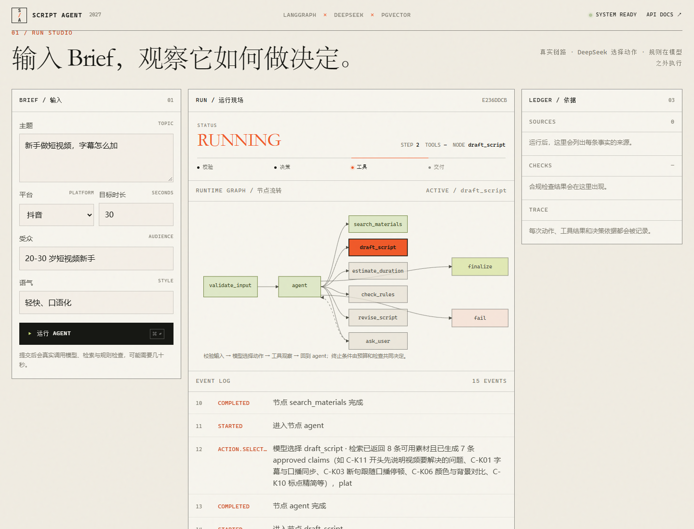
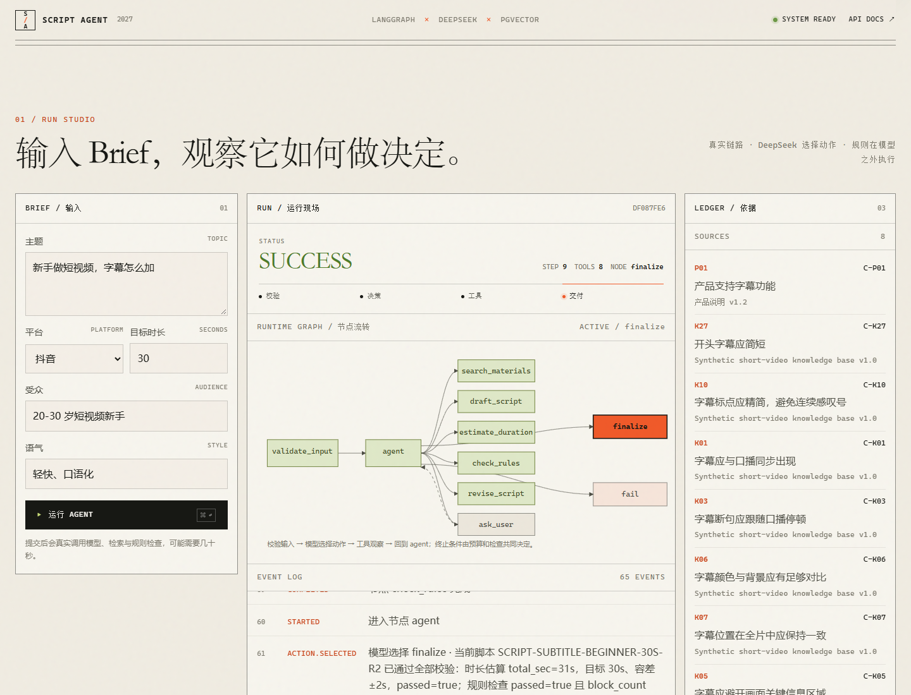
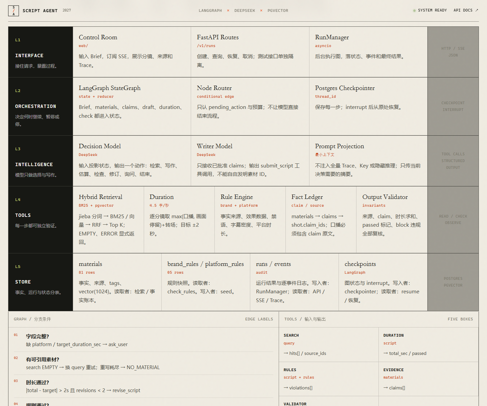
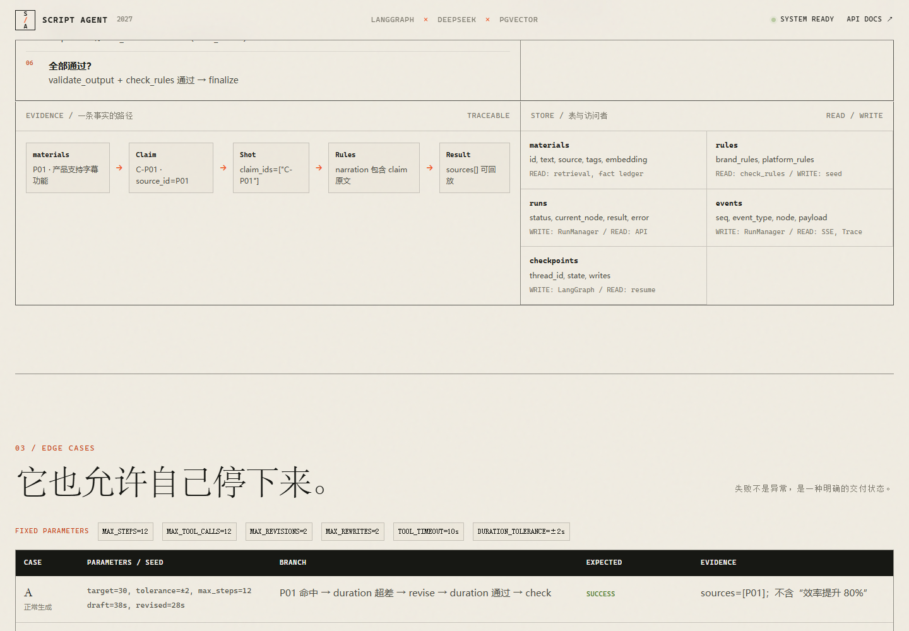
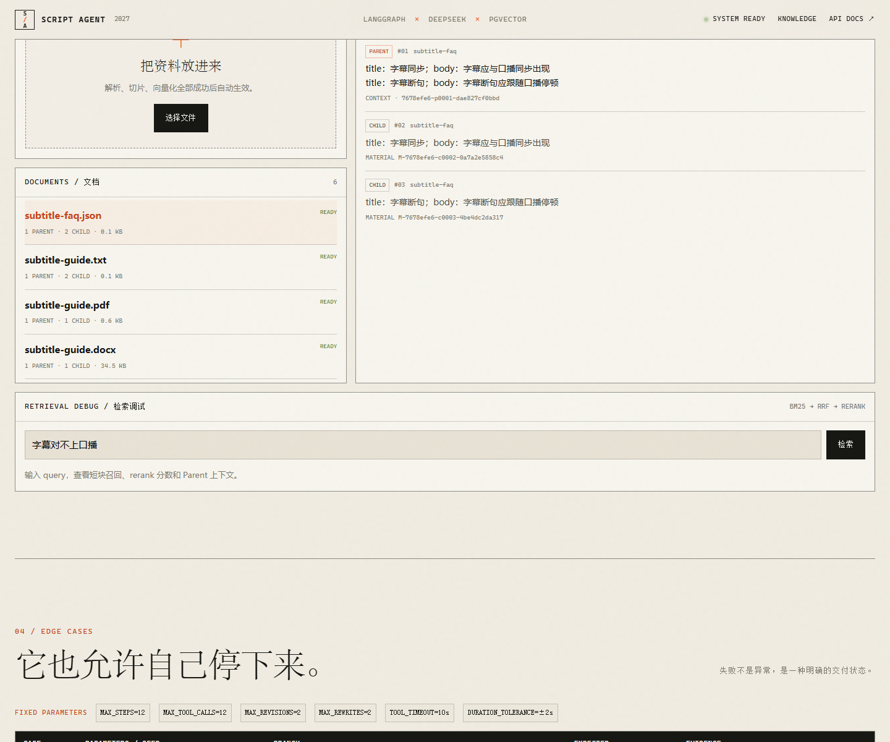
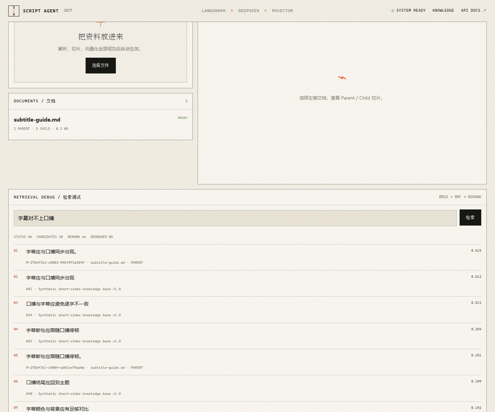
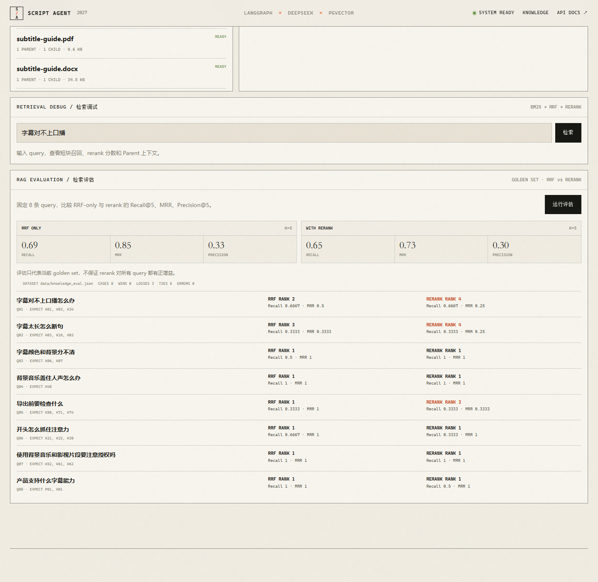

# 短视频脚本 Agent（P0）

面向短视频脚本生成的确定性 Agent 后端。模型只负责“选动作”和“写脚本”，状态、预算、工具执行、事实校验、暂停恢复和终态由 LangGraph 自定义图控制。

- 编排：LangGraph `StateGraph` + PostgreSQL checkpointer
- 模型：DeepSeek（OpenAI 兼容，模型由 `DEEPSEEK_MODEL` 指定）
- Embedding：DashScope `text-embedding-v3`（原生 API，1024 维）
- 检索：BM25 + pgvector + RRF
- API：FastAPI + SSE
- 测试：pytest / ASGI 内存容器 / Mock 场景

文档：[需求](docs/01-requirements.md) · [方案](docs/02-solution.md) · [评估](docs/03-evaluation.md) · [AI 使用](docs/04-ai-usage.md) · [复盘](docs/05-retrospective.md)

## 1. 设计原则

1. **模型与运行时分离**：不使用 `AgentExecutor` 包整条流程。`ChatOpenAI.bind_tools()` 只输出一个动作；LangGraph 负责路由、预算、工具、检查点和中断。
2. **不编造成功**：无素材、工具失败、超时长和规则不可满足都有显式状态；没有来源的事实无法以 `SUCCESS` 返回。
3. **确定性优先**：时长、规则、事实子串、RRF、输出不变量全部是纯函数；真实模型只做人工冒烟，不参与 CI 断言。
4. **可回放**：每次运行写入 `events`，SSE 支持 `Last-Event-ID`；Trace 可从事件重建。
5. **最小上下文**：Writer/Decision 只看到 Brief、claims、摘要和违规，不接收全量历史、Key 或隐藏推理。

> [!NOTE]
> 当前 DeepSeek 模型处于 thinking mode 时，API 不支持强制指定 `function` tool_choice。Writer 使用 `tool_choice="auto"`，再校验必须返回 `submit_script`；Decision 同样使用 `auto`。不要改回强制 `tool_choice`。

## 2. 架构

```text
POST /v1/runs
   │
   ▼
RunManager ── astream ──► validate_input
                            ├─ 缺 platform/时长 → ask_user (interrupt)
                            └─ agent
                                 │ 模型选择一个动作
        ┌────────────────────────┼───────────────────────────┐
        ▼                        ▼                           ▼
 search_materials          draft/estimate/check/revise    ask/finalize/fail
        └──────────────► agent ◄───────────────────────────┘
                                 │
                              END
```

关键不变量：

- `search.status=ERROR` → `TOOL_ERROR`，不降级为纯 BM25，不伪造结果。
- `EMPTY` 且重写次数耗尽 → `NO_MATERIAL`。
- 时长超出 `target ± 2s` 且修订次数耗尽 → `UNSATISFIABLE_DURATION`。
- block 违规且修订次数耗尽 → `UNSATISFIABLE_RULES`。
- 达到步数/工具预算 → `MAX_STEPS`。
- 只有 `validate_output` 和规则检查都通过才返回 `SUCCESS`。

## 3. 目录

```text
src/
  config.py                 # pydantic-settings
  api/                      # FastAPI、SSE、路由、依赖
  graph/                    # State、节点、路由、图构建
  domain/                   # Pydantic 模型、时长、规则、输出校验
  knowledge/                # 文档解析、Parent/Child 切片、入库、仓库
  llm/                      # DeepSeek/Mock 适配与 Prompt
  tools/                    # BM25、embedding、RRF、rerank、规则仓库
  runtime/                  # RunManager、存储、checkpointer、场景运行器
  observability/            # 事件常量与 Trace
scripts/
  migrate.py                # pgvector/表/索引/维度检查
  seed_data.py              # 幂等种子 + embedding
  smoke_model.py            # 真实模型冒烟（人工）
  run_api.py                # Windows SelectorEventLoop 启动器
  reproduce_examples.py     # 重放 6 个验收场景并导出 Trace
web/                        # 运行控制台（原生 HTML/CSS/JS，无构建链）
uploads/                    # 上传原文件（gitignored）
data/                       # 合成素材与规则
examples/scenarios/         # 6 个可执行验收场景
examples/traces/            # 生成的 JSONL Trace
examples/results/           # 生成的同步结果
tests/                      # 单元/图/API 测试
docs/                       # 需求、方案、评估、AI 使用、复盘
  01-requirements.md
  02-solution.md
  03-evaluation.md
  04-ai-usage.md
  05-retrospective.md
  implementation-plan.md
```

## 4. 快速开始

### 4.1 依赖

Python 3.11+。计划使用 `uv`；若本机没有，可用 pip 等价安装：

```bash
uv sync
# 或
python -m pip install -e ".[dev]"
```

### 4.2 配置

```bash
cp .env.example .env
```

至少填写：

- `DEEPSEEK_API_KEY`
- `DASHSCOPE_API_KEY`
- `DATABASE_URL`（外部 PostgreSQL，已安装 pgvector，当前库有建表权限）

### 4.3 数据库与种子

```bash
uv run python scripts/migrate.py
uv run python scripts/seed_data.py
```

`migrate.py` 只操作当前库，不执行 `CREATE DATABASE`。缺少 pgvector、无权限或维度不是 1024 会明确失败。

### 4.4 启动

Windows 必须使用 selector loop 启动器；直接 `uvicorn` 会让 psycopg async 遇到 `ProactorEventLoop`：

```bash
python scripts/run_api.py
```

Linux/macOS 可以直接：

```bash
uvicorn src.api.app:app --host 127.0.0.1 --port 8000
```

检查：

```bash
curl -i http://127.0.0.1:8000/healthz
curl -i http://127.0.0.1:8000/readyz
```

`/healthz` 在配置缺失时返回 503；`/readyz` 检查数据库、pgvector、表和 embedding 维度。

### 4.5 运行控制台

启动 API 后打开：

```text
http://127.0.0.1:8000/app/
```

控制台直接调用真实 `/v1/runs` 和 SSE：

- 输入 Brief，观察动作、工具和状态；
- 运行中显示 `RUNNING`、步数、当前节点，并在流程图上高亮当前节点；
- 完成后展示分镜、Fact Ledger 和 Trace；
- 支持 `?run=<id>` 打开历史运行；
- 失败状态会显示具体原因，不伪装成成功。

前端源码在 `web/`，只使用原生 HTML/CSS/JS，不需要 Node 或构建步骤。


运行中，当前节点 `draft_script` 高亮，已经走过的节点保留完成态：



运行完成后，分镜、来源和规则检查会同时展开：



系统分层、分支条件、工具输入输出和数据库访问关系：



边界场景的参数、分支和期望状态：



### 4.6 知识库

控制台支持拖拽上传 PDF、DOCX、TXT、MD、CSV、JSON。上传后异步执行：

```text
解析 → Parent/Child 切片 → Child embedding → 原子发布
```

上传接口：

```bash
curl -s -X POST http://127.0.0.1:8000/v1/knowledge/documents \
  -F "file=@examples/knowledge/subtitle-guide.md"
```

界面提供文档列表、入库进度、Parent/Child 预览、下架、永久删除和检索调试。检索调试会展示 BM25 + 向量 + RRF + rerank 的最终排序和 Parent 上下文。

- **下架**：保留记录和原文件，只退出检索；
- **永久删除**：删除文档、切片、材料、入库任务和 `uploads/` 原文件，不可恢复；正在入库的文档拒绝删除。



检索调试可以看到短块命中、rerank 分数和 Parent 上下文：



默认参数：

```text
CHILD: 20–120 字，一句/一行/一条记录
PARENT: 300–800 字，3–8 个 Child
检索: BM25 Top 30 + 向量 Top 30
融合: RRF k=60
精排: DashScope gte-rerank-v2, Top 8
返回: Top 4 Parent 上下文
```

reranker 失败时重试一次；仍失败则回退 RRF，并在 `result.risks` 写入：

```text
RERANK_DEGRADED
```

检索评估面板使用固定 8 条 query，比较 RRF-only 与 rerank 的 Recall@5、MRR、Precision@5：

```text
GET /v1/knowledge/evaluation?k=5
```



当前 golden set 的结果是：RRF MRR 0.85，rerank MRR 0.73。  
面板没有假设 rerank 一定更好，而是把增益/损失如实展示；这也是为什么 `RERANK_DEGRADED` 必须显式记录。

PDF 只解析文本层；扫描件需要 OCR，当前不在范围内。

### 4.7 测试

```bash
python -m pytest -q
python scripts/reproduce_examples.py
```

默认测试不访问数据库、DeepSeek 或 DashScope。设置 `TEST_DATABASE_URL` 后，会额外执行只读 PostgreSQL/pgvector 集成测试：

```powershell
$env:TEST_DATABASE_URL = $env:DATABASE_URL
python -m pytest -q
```

真实模型冒烟单独执行：

```bash
python scripts/smoke_model.py
```

冒烟失败只记录失败，不把 Mock 结果伪装成真实模型结果。

## 5. API

| 方法 | 路径 | 说明 |
| --- | --- | --- |
| POST | `/v1/runs` | 创建运行，202 |
| GET | `/v1/runs/{id}` | 状态、当前节点、step、缺失字段 |
| GET | `/v1/runs/{id}/result` | 最终结果；未完成 409 |
| GET | `/v1/runs/{id}/events` | SSE；支持 `Last-Event-ID` |
| GET | `/v1/runs/{id}/trace` | JSON Trace；`?format=jsonl` 导出 |
| POST | `/v1/runs/{id}/resume` | 仅 `WAITING_INPUT`，否则 409 |
| POST | `/v1/runs/{id}/cancel` | 取消；已结束 409 |
| POST | `/v1/test/runs` | 同步 Mock 验收场景 |
| POST | `/v1/knowledge/documents` | multipart 上传，202 |
| GET | `/v1/knowledge/documents` | 文档列表 |
| GET | `/v1/knowledge/documents/{id}` | 文档详情 |
| GET | `/v1/knowledge/documents/{id}/chunks` | Parent/Child 预览 |
| GET | `/v1/knowledge/jobs/{id}` | 入库进度 |
| POST | `/v1/knowledge/documents/{id}/deactivate` | 下架并退出检索 |
| DELETE | `/v1/knowledge/documents/{id}` | 永久删除文档、切片、材料、任务和原文件 |
| GET | `/v1/knowledge/evaluation` | 固定 query 集：RRF vs rerank 指标 |
| POST | `/v1/knowledge/search` | 检索调试：RRF + rerank |
| GET | `/healthz` | 进程/配置 |
| GET | `/readyz` | DB/pgvector/embedding/checkpointer |

### 创建运行

```bash
curl -s -X POST http://127.0.0.1:8000/v1/runs \
  -H 'content-type: application/json' \
  -d '{
    "brief": {
      "topic": "新手做短视频，字幕怎么加",
      "audience": "20-30 岁短视频新手",
      "platform": "抖音",
      "target_duration_sec": 30,
      "style": "轻快、口语化"
    }
  }'
```

### 等待输入与恢复

缺 `platform` 或 `target_duration_sec` 时：

```json
{
  "status": "WAITING_INPUT",
  "missing_fields": ["platform", "target_duration_sec"]
}
```

```bash
curl -s -X POST http://127.0.0.1:8000/v1/runs/<id>/resume \
  -H 'content-type: application/json' \
  -d '{"answer": {"platform": "抖音", "target_duration_sec": 30}}'
```

### SSE

```text
id: 12
event: tool.result
data: {"run_id":"...","seq":12,"node":"search_materials","status":"OK","source_ids":["P01"]}
```

### 测试接口

`ENABLE_TEST_API=false` 时返回 404。示例：

```bash
curl -s -X POST http://127.0.0.1:8000/v1/test/runs \
  -H 'content-type: application/json' \
  -d @examples/test-request.json
```

## 6. 验收场景

| 场景 | 结果 | Trace |
| --- | --- | --- |
| A 正常生成（38→28） | `SUCCESS`，引用 P01 | [a_normal_generation](examples/traces/a_normal_generation.jsonl) |
| B 缺关键信息 | `WAITING_INPUT`，不猜 | [b_missing_information](examples/traces/b_missing_information.jsonl) |
| C 连续无素材 | `NO_MATERIAL`，无脚本 | [c_no_material](examples/traces/c_no_material.jsonl) |
| D 检索工具失败 | `TOOL_ERROR`，不伪造 | [d_tool_error](examples/traces/d_tool_error.jsonl) |
| E 超时长且无法满足 | `UNSATISFIABLE_DURATION` | [e_unsatisfiable_duration](examples/traces/e_unsatisfiable_duration.jsonl) |
| F 预算耗尽 | `MAX_STEPS`，明确未完成 | [f_max_steps](examples/traces/f_max_steps.jsonl) |

运行 `python scripts/reproduce_examples.py` 可生成/校验全部 Trace 和结果。详细说明见 [docs/03-evaluation.md](docs/03-evaluation.md)。

## 7. 数据模型与约束

- `knowledge_documents` 保存来源文件与入库状态；
- `knowledge_chunks` 保存 parent/child 块，child 才有 embedding；
- `materials` 保存可引用的 child 事实，`chunk_id/parent_id/document_id` 指回来源；
- 检索命中 child，返回 parent 上下文，Writer 只能引用 child 对应事实；
- 素材只从 `materials` 读取；`active=true` 才进入索引。
- Writer 只能引用由检索结果生成的 claims；图节点会二次检查 claim ID 白名单。
- 口播必须包含 claim 原文（规范化空白/标点后做子串检查）。
- 效果数据结论只能引用带 `effect_data` 标签或包含数据的素材。
- 字幕每秒字符数过高只产生 `warn`，不阻断。
- `audience` / `style` 缺省时补默认值，并在 `risks` 中记录 `DEFAULTED_FIELD`。
- 时长报告写回 `Shot.duration_sec`，保证 `total_sec == sum(shot.duration_sec)`。

## 8. 已知边界

- 入库和运行都是进程内 `asyncio` 任务，没有 Redis/Celery；
- 取消标记在进程内维护；进程重启后遗留 `RUNNING` 会被标记为 `INTERRUPTED`；
- PDF 只解析文本层，扫描件 OCR 不在范围内；
- reranker 失败会显式降级为 RRF，并写入 `RERANK_DEGRADED`，不伪装成精排成功；
- 真实 PostgreSQL、DeepSeek 与 DashScope 已完成联调（见第 9 节）；生产级并发/队列/多实例仍未验证；
- 本机若没有安装 `uv`，请使用 `.venv` 的 `python`；`uv.lock` 已生成，环境差异时以 `pyproject.toml` 为准。

## 9. 真实环境联调记录

2026-11-03 在本机完成真实依赖联调：

- PostgreSQL 18 + pgvector 0.8.7，`materials.embedding=vector(1024)`；
- `python scripts/migrate.py`：成功；
- `python scripts/seed_data.py`：P01 + 4 条品牌规则 + 1 条平台规则；
- `python scripts/smoke_model.py`：DeepSeek 动作 + DashScope 1024 维 embedding 成功；
- 真实上传并解析六种格式：PDF、DOCX、TXT、MD、CSV、JSON；
- 真实检索链路：BM25 + pgvector + RRF + `gte-rerank-v2`；
- 真实 API 生成：`SUCCESS`，10 步，28 秒，引用上传素材和种子素材；
- `TEST_DATABASE_URL` 指向真实库：`42 passed`。

真实运行证据：

- [examples/results/real_normal_30s.json](examples/results/real_normal_30s.json)
- [examples/traces/real_normal_30s.jsonl](examples/traces/real_normal_30s.jsonl)
- [examples/results/real_knowledge_30s.json](examples/results/real_knowledge_30s.json)
- [examples/traces/real_knowledge_30s.jsonl](examples/traces/real_knowledge_30s.jsonl)

真实模型输出不保证严格 38→28；该数值属于 Mock 验收场景。真实运行验证的是结构、事实来源、Parent 上下文和失败边界。
